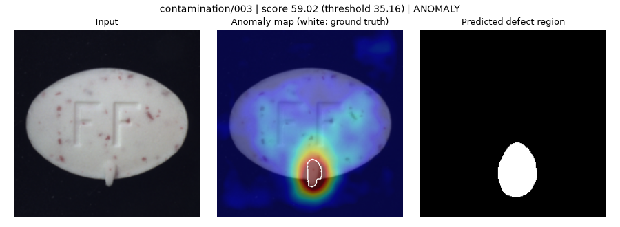
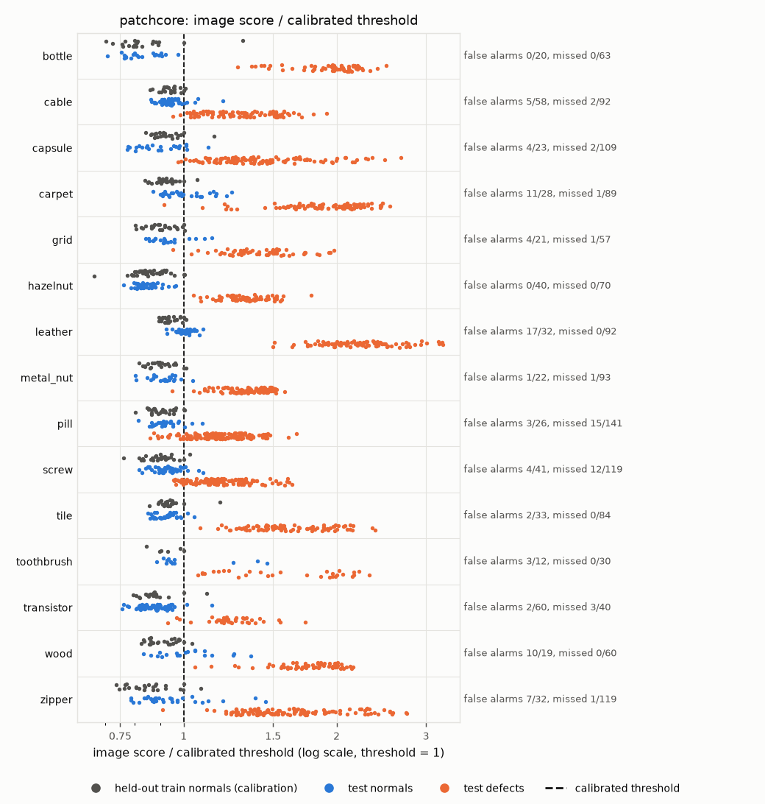
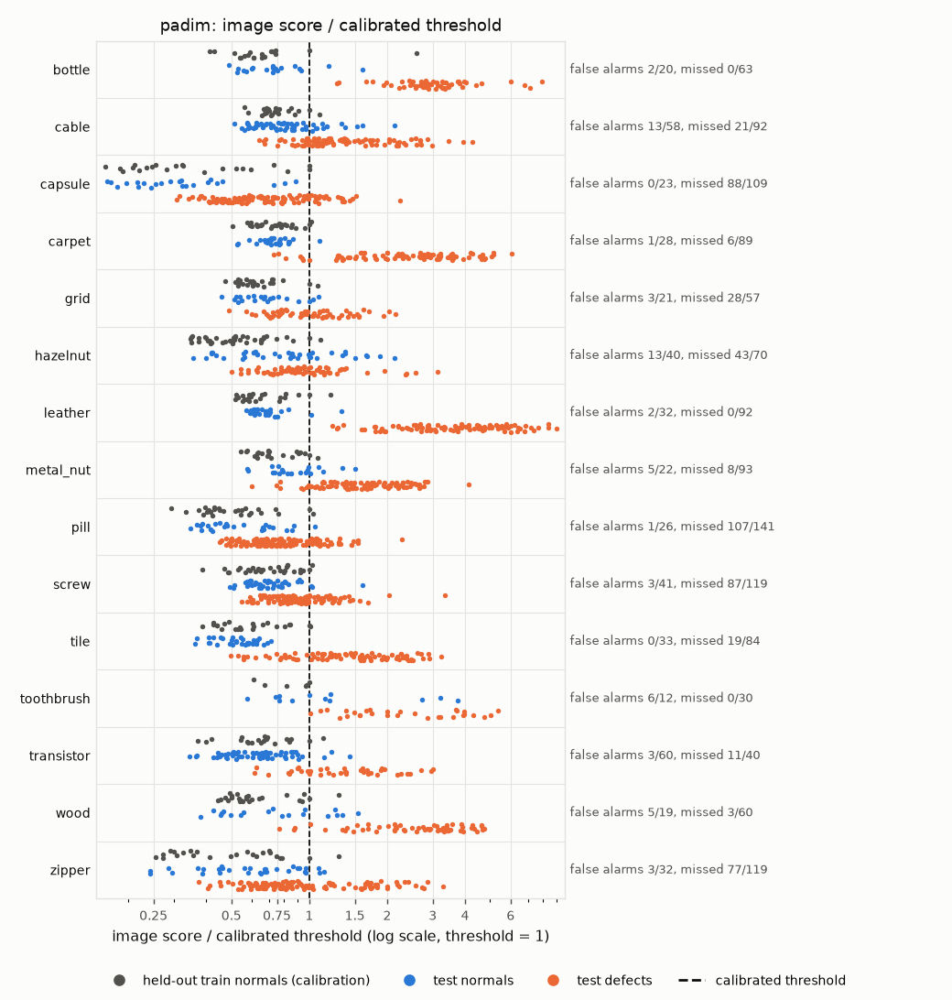
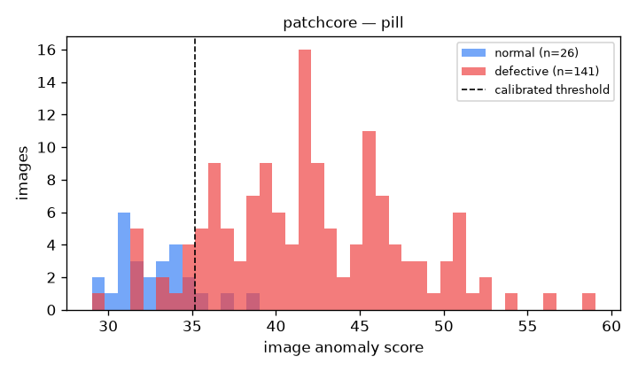
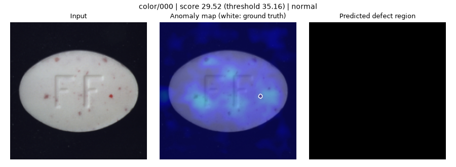
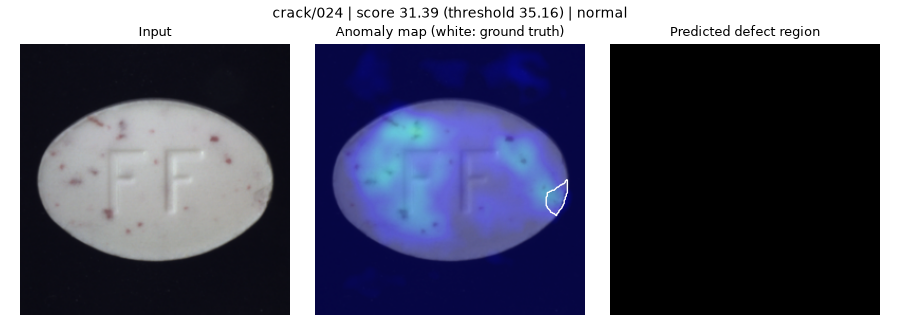
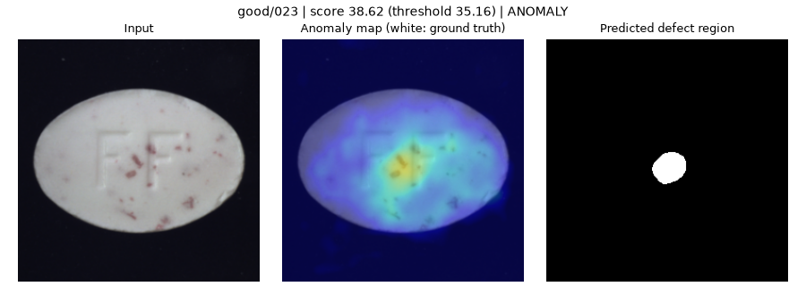
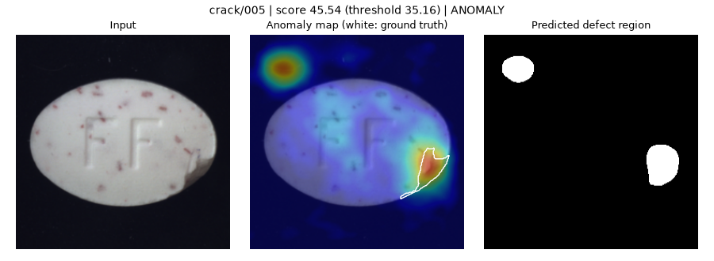
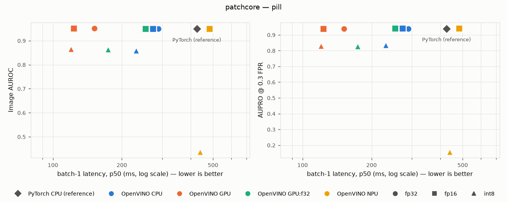
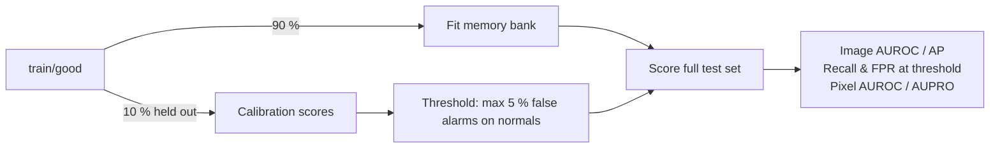

# Industrial Anomaly Detection

[](https://github.com/Zeta-12/industrial-anomaly-detection/actions/workflows/ci.yml)

Unsupervised defect detection for visual inspection. The model only sees defect-free images during fitting, then it
has to flag cracks, contamination, scratches or wrong imprints on new parts and show where they are.



The models are standard (PatchCore and PaDiM, through [anomalib](https://github.com/open-edge-platform/anomalib)).
Most of the work here went into the evaluation. A lot of anomaly detection demos choose their threshold on the test
set or only report image AUROC. Here the decision threshold is calibrated on held-out good images only, and the
localisation is measured at pixel level.

## Results

### MVTec AD, 15 categories

PatchCore (WideResNet-50-2, `layer2` + `layer3`, 10 % coreset) and PaDiM (ResNet-18, the anomalib default,
`layer1` to `layer3`), 256x256 input, full test sets (467 good / 1258 defective images). In each category 10 % of
`train/good` is held out to calibrate the threshold (target: 5 % false alarms) and the rest is used for fitting.
Fitted on an RTX 3060 Ti: 16 min for the 15 categories with PatchCore, 2 min with PaDiM.

Each cell is PatchCore / PaDiM.

| Category | Image AUROC | Pixel AUROC | AUPRO@0.3 | Recall @cal. | FPR @cal. |
|---|---|---|---|---|---|
| bottle | 1.000 / 0.998 | 0.985 / 0.981 | 0.939 / 0.930 | 1.000 / 1.000 | 0.000 / 0.100 |
| cable | 0.986 / 0.854 | 0.984 / 0.965 | 0.928 / 0.873 | 0.978 / 0.772 | 0.086 / 0.224 |
| capsule | 0.990 / 0.890 | 0.990 / 0.981 | 0.924 / 0.893 | 0.982 / 0.193 | 0.174 / 0.000 |
| carpet | 0.986 / 0.986 | 0.991 / 0.988 | 0.938 / 0.949 | 0.989 / 0.933 | 0.393 / 0.036 |
| grid | 0.990 / 0.840 | 0.983 / 0.930 | 0.910 / 0.810 | 0.982 / 0.509 | 0.190 / 0.143 |
| hazelnut | 1.000 / 0.617 | 0.988 / 0.969 | 0.890 / 0.827 | 1.000 / 0.386 | 0.000 / 0.325 |
| leather | 1.000 / 0.999 | 0.992 / 0.988 | 0.973 / 0.974 | 1.000 / 1.000 | 0.531 / 0.062 |
| metal_nut | 0.997 / 0.921 | 0.987 / 0.947 | 0.935 / 0.839 | 0.989 / 0.914 | 0.045 / 0.227 |
| pill | 0.947 / 0.795 | 0.980 / 0.936 | 0.941 / 0.905 | 0.894 / 0.241 | 0.115 / 0.038 |
| screw | 0.975 / 0.786 | 0.989 / 0.979 | 0.942 / 0.906 | 0.899 / 0.269 | 0.098 / 0.073 |
| tile | 1.000 / 0.965 | 0.955 / 0.912 | 0.860 / 0.770 | 1.000 / 0.774 | 0.061 / 0.000 |
| toothbrush | 0.914 / 0.811 | 0.989 / 0.984 | 0.883 / 0.894 | 1.000 / 1.000 | 0.250 / 0.500 |
| transistor | 0.993 / 0.935 | 0.972 / 0.973 | 0.944 / 0.883 | 0.925 / 0.725 | 0.033 / 0.050 |
| wood | 0.988 / 0.966 | 0.931 / 0.922 | 0.885 / 0.866 | 1.000 / 0.950 | 0.526 / 0.263 |
| zipper | 0.978 / 0.737 | 0.981 / 0.971 | 0.933 / 0.908 | 0.992 / 0.353 | 0.219 / 0.094 |
| **mean** | 0.983 / 0.873 | 0.980 / 0.962 | 0.922 / 0.882 | 0.975 / 0.668 | 0.181 / 0.142 |

Full tables with image AP and oracle F1: [`mvtec_patchcore.md`](docs/assets/mvtec_patchcore.md),
[`mvtec_padim.md`](docs/assets/mvtec_padim.md). All 30 `metrics.json`, with the calibration scores:
[`mvtec_metrics.json`](docs/assets/mvtec_metrics.json).

1. **PatchCore is much better on objects, PaDiM is close on textures.** Mean image AUROC is 0.983 against 0.873. On
   the 5 textures the gap is small (0.993 vs 0.951), on the 10 objects it is large (0.978 vs 0.834), and the worst
   case is hazelnut (1.000 vs 0.617). PaDiM fits one Gaussian per patch position, so it expects the parts to be
   aligned, and hazelnut and screw are photographed at random orientations. PatchCore compares each patch with the
   whole memory bank, wherever the patch is. This is not a same-backbone comparison: PaDiM uses a ResNet-18 here, and
   it fits 7x faster.
2. **A high AUROC does not give a usable threshold.** At the calibrated threshold PatchCore raises 73 false alarms
   on 467 good test images (15.6 %, for a 5 % target). On leather it flags 17 of the 32 good images, with an image
   AUROC of 1.000. The calibration itself works: on the calibration images, every category gets 1 false alarm out of
   21 to 39 (0 out of 6 for toothbrush), which is at most 5 %. The problem is that the held-out train normals and
   the test normals don't have the same score distribution. In the figure below every score is divided by the
   threshold. On leather, wood and carpet the test normals (blue) sit to the right of the calibration normals
   (grey). Measured as an AUROC between the two groups (0.5 = same distribution), the shift is 0.875 on leather,
   0.790 on carpet, 0.773 on wood and 0.704 on zipper. It stays around 0.5 on bottle, cable, hazelnut and tile,
   which stay between 0 and 9 % false alarms. The PatchCore threshold also has very little margin: on average it is
   only 1.12x the median calibration score. I can't tell from these numbers whether the shift comes from different
   acquisition conditions between the train and test folders or from near-duplicates inside `train/good`. Either
   way, a threshold calibrated on images from the training pool is optimistic.
3. **With a few dozen calibration images, one or two outliers can set the threshold.** PaDiM only detects 760 of
   the 1258 defects (60 %) at its calibrated threshold, against 0.918 oracle F1. On capsule, the two highest
   calibration scores are 3.2x the median (76.6 against 24.0). One of them looks like any other capsule to me, and
   PatchCore ranks it 11th of 22. The threshold ends up above most of the defects: 88 of 109 are missed, for an
   image AUROC of 0.890. Neither problem shows up in AUROC or in the oracle F1. On a real line I would calibrate on
   a larger set of recent production images and keep monitoring the false alarm rate after deployment.

<p>


</p>

### Pill in detail

The rest of the results use the pill category, fitted on the laptop CPU (Intel Core Ultra 5 235U), full test set
(26 good / 141 defective images). The GPU fit of the same category gives 0.947 image AUROC instead of 0.949 and 15
missed defects instead of 13: CPU and GPU floating point results are not bit-identical, so the coreset and the
scores differ slightly.

| Category | Image AUROC | Image AP | Pixel AUROC | AUPRO@0.3 | Recall @cal. | FPR @cal. | Oracle F1* |
|---|---|---|---|---|---|---|---|
| pill | 0.949 | 0.991 | 0.981 | 0.940 | 0.908 | 0.115 | 0.950 |

\*Oracle F1 uses the best threshold on the test set, so it is an upper bound and not a real operating point.

With the threshold set for 5 % false alarms on the held-out good pills, the model detects 128 of the 141 defective
pills (91 %). On the test set it gives 3 false alarms out of 26 good pills (11.5 %), which is above the 5 % target:
with only 27 calibration images the actual false alarm rate is noisy (see [Limitations](#limitations)). Calibrated
F1 is 0.941 against 0.950 for the oracle, and this gap is exactly what tuning on the test set would hide.

| Defect type | Detected |
|---|---|
| combined | 17 / 17 (100 %) |
| pill_type | 9 / 9 (100 %) |
| scratch | 23 / 24 (96 %) |
| contamination | 20 / 21 (95 %) |
| faulty_imprint | 18 / 19 (95 %) |
| crack | 21 / 26 (81 %) |
| color | 20 / 25 (80 %) |
| *good (false alarms)* | *3 / 26 (12 %)* |



#### Error analysis

| | |
|---|---|
|  | Missed colour defect: a dot of a few pixels at 256x256, with the same colour as the red speckles that every normal pill has. PatchCore features have a stride of 8 px, so it is a resolution problem. A higher input resolution or tiling should help. |
|  | Missed crack: faint and low contrast, on the edge of the pill where the normal variation is the highest. Colour and crack are the two weakest defect types (80-81 %). |
|  | False alarm: the good pill with the highest score. The dense speckles around the "FF" imprint look unusual to the model. |
|  | The crack is detected, but there is a second hot spot on the black background. Masking the background (segmenting the pill first) would remove this kind of false alarm. |

Compute (Intel Core Ultra 5 235U, CPU only): fitting takes 24 min, almost all of it in the coreset subsampling.
Scoring takes 0.55 s per image end to end, mostly in the nearest neighbour search. On the RTX 3060 Ti the same fit
takes 71 s and scoring 32 ms per image.

## Edge deployment: CPU, iGPU and NPU

I exported the fitted model to OpenVINO and benchmarked it on the three compute units of the same laptop chip (Intel
Core Ultra 5 235U). Accuracy is measured again on each target, because two things can change it:

- The GPU and the NPU run in FP16 by default, and the PatchCore score is a distance computed as
  `||x||^2 + ||y||^2 - 2 x.y` against a memory bank of 24k vectors, which can lose precision in FP16. `GPU:f32` is
  the same iGPU forced to FP32, to separate the effect of the precision from the effect of the hardware.
- INT8 is post-training quantization with NNCF, calibrated on the 27 held-out good images (no defect is used). This
  first export only excluded the nearest neighbour MatMul from quantization, which was not enough (see point 3 and
  the [INT8 section](#int8-backbone-and-int8-memory-bank)).

| Protocol | |
|---|---|
| Latency | batch 1, synchronous, `PERFORMANCE_HINT=LATENCY`, 10 warm-up + 100 timed runs, p50 / p90 / p99 |
| Accuracy | full test set through the compiled model, same calibrated threshold protocol as PyTorch |
| Agreement | Spearman correlation and max absolute score difference with PyTorch, per image |
| Baseline | PyTorch FP32 (eager) on the same CPU, same input, same loop |
| Conditions | AC power and battery saver checked and saved with the results (`iad devices`), failed runs are kept in the table |

### Results: pill, Intel Core Ultra 5 235U, on AC power



| Runtime / device / weights | Exec. | p50 (ms) | FPS | Image AUROC | AUPRO | Recall @cal. | Spearman vs PyTorch |
|---|---|---|---|---|---|---|---|
| PyTorch / CPU / fp32 (reference) | f32 | 424.8 | 2.3 | 0.949 | 0.940 | 0.908 | 1.000 |
| OpenVINO / CPU / fp16 | f32 | 273.2 | 3.7 | 0.950 | 0.940 | 0.908 | 1.000 |
| **OpenVINO / iGPU / fp16** | f16 | **123.3** | **8.1** | **0.950** | **0.940** | 0.901 | 0.999 |
| OpenVINO / iGPU forced to FP32 / fp16 | f32 | 253.2 | 3.9 | 0.950 | 0.940 | 0.908 | 1.000 |
| OpenVINO / NPU / fp16 | f16 | 482.2 | 2.1 | 0.949 | 0.940 | 0.908 | 1.000 |
| OpenVINO / CPU / int8 (first export, see 3) | f32 | 230.7 | 4.4 | 0.859 | 0.835 | 0.610 | 0.878 |
| OpenVINO / NPU / int8 (first export, see 3) | f16 | 438.5 | 2.3 | 0.438 | 0.159 | 0.043 | -0.066 |

All 13 runs with p90 / p99 and compile times are in [`benchmark_pill.md`](docs/assets/benchmark_pill.md), raw numbers
and environment in [`benchmark_pill.json`](docs/assets/benchmark_pill.json).

1. **The iGPU in FP16 is the best option: 3.4x faster than PyTorch with the same accuracy.** 123 ms per image
   (8.1 FPS) against 425 ms, same AUROC and AUPRO, and a Spearman correlation of 0.999 with the PyTorch scores. The
   latency is also much more stable: std of about 1 ms on the iGPU against 29 ms for PyTorch on the CPU.
2. **FP16 is fine for this model.** I expected precision problems in the distance, but the squared norms of the
   memory bank vectors stay below 9.3k (the FP16 max is 65.5k) and the largest score difference is 0.77, for a
   threshold of 35. FP16 makes the iGPU twice as fast as FP32 (123 vs 253 ms). The operating point moves by one image
   each way (2 false alarms instead of 3, 127 detections instead of 128), within the noise of a 27-image calibration
   set.
3. **The first INT8 export was broken.** It quantized the whole graph except the nearest neighbour MatMul: 20 %
   faster on the CPU, 3 % on the iGPU, but recall dropped from 91 % to 61 %. Looking at the IR, excluding the MatMul
   did not protect the distance: NNCF still added 8-bit FakeQuantize nodes on the inputs of the `Power`, `ReduceSum`
   and `Sqrt` ops that compute the distance, and on the blur of the anomaly map. So the anomaly score itself was
   computed from 8-bit values. The fix is described below.
4. **The NPU is the slowest target.** In FP16 it is accurate and very stable (std of 0.5 ms), but at 482 ms it is
   slower than the CPU. My guess is that a large dense MatMul followed by a TopK over 24k vectors is a bad fit for
   it. I don't know yet why it collapsed with the broken INT8 export (Spearman -0.07, against 0.88 on the CPU with
   the same IR). It still has to be tested again with the backbone-only INT8 model.

### INT8 backbone and INT8 memory bank

To quantize only the feature extractor, the model is split in two:

- stage 1: backbone and embedding, exported to OpenVINO (FP32 or INT8, same 27 calibration images). All 58
  FakeQuantize nodes are in the backbone and the pooling;
- stage 2: anomalib's nearest neighbour head, in FP32.

A second memory bank is built from the INT8 features of the 240 fitting images, with the same coreset algorithm
(KCenterGreedy, 10 %, 18 min on CPU).

| Variant | Threshold | Image AUROC | Pixel AUROC | AUPRO | Detected (/141) | False alarms (/26) | Stage 1, CPU p50 |
|---|---|---|---|---|---|---|---|
| FP32 features + FP32 bank (= PyTorch) | 35.2 | 0.949 | 0.981 | 0.940 | 128 | 3 | 84.0 ms |
| INT8 features + FP32 bank | 38.8 | 0.935 | 0.952 | 0.882 | 125 | 2 | 22.3 ms |
| **INT8 features + INT8 bank** | 35.8 | **0.944** | **0.979** | **0.934** | 127 | 3 | **22.6 ms** |

- The split gives the same scores as PyTorch (Spearman 1.000, max difference 0.01).
- With INT8 queries against the FP32 bank, localisation suffers more than detection: -0.058 AUPRO but only -0.014
  image AUROC. The calibrated threshold goes up from 35.2 to 38.8 because every query ends up further from the bank.
- Rebuilding the bank from INT8 features recovers most of it: the threshold comes back to 35.8 and AUPRO is only
  0.006 below FP32. The remaining gap is one detection out of 141, on a single test set.
- The INT8 backbone is 3.7x faster (84 -> 22.6 ms on CPU). The bottleneck is now the nearest neighbour head (325 ms
  in PyTorch on CPU). Next step: run the head in OpenVINO FP16 on the iGPU and stage 1 on the NPU.

Full table: [`int8_bank_pill.md`](docs/assets/int8_bank_pill.md), raw numbers:
[`int8_bank_pill.json`](docs/assets/int8_bank_pill.json), code: [`int8_bank.py`](src/industrial_ad/int8_bank.py). To
reproduce: `uv run iad int8-bank --category pill`.

Not measured: power consumption (no reliable per-device telemetry on this laptop). The first compilation takes about
30 s on the NPU, so a real deployment should cache the compiled models (`CACHE_DIR`).

```bash
uv sync --extra openvino
uv run iad devices                          # devices, NPU driver, AC power
uv run iad benchmark --category pill        # export fp32/fp16/int8, then CPU, GPU, GPU:f32, NPU
```

Results are written to `runs/<model>/<category>/benchmark/`: `results.json` (all the numbers and the environment),
`results.md` and `latency_accuracy.png`.

## Evaluation protocol



| Choice | Why |
|---|---|
| Threshold calibrated on held-out good images | On a real production line there are no labelled defects to tune on. Choosing the threshold that maximises F1 on the test set uses the test labels, so this "oracle F1" is only reported as an upper bound. |
| Full test set, stratified subsampling for quick runs | Taking the first *N* files (sorted by folder) would only cover two of the seven defect types. |
| Pixel AUROC and AUPRO@0.3 | Image AUROC tells if a part is defective, AUPRO tells if the defect is found at the right place. Each defect region has the same weight, so a small contamination counts as much as a large crack. |
| Raw model scores | anomalib's post-processor min-max normalises the scores and clips them to [0, 1]. Saturated scores create ties that bias the ranking metrics. |
| Heat maps on a shared colour scale | With per-image min-max normalisation every image gets a red spot, good ones included. Here the middle of the colour scale is the decision threshold, on every image. |

The metrics are in [`metrics.py`](src/industrial_ad/metrics.py) and are tested on cases with a known answer (perfect
maps, random maps, regions of very different sizes).

## Quickstart

Requires Python 3.11 to 3.13 and [uv](https://docs.astral.sh/uv/).

```bash
git clone https://github.com/Zeta-12/industrial-anomaly-detection.git
cd industrial-anomaly-detection
uv sync                     # CPU wheels

uv run iad download         # MVTec AD, 4.9 GB, CC BY-NC-SA 4.0 (non-commercial), into datasets/MVTecAD
uv run iad run --category pill                 # fit + calibrate + evaluate one category
uv run iad run --category all --model padim    # all categories, other model
uv run iad summary --model patchcore           # markdown table and calibration figure of the evaluated categories
```

On an NVIDIA GPU, replace the CPU wheels with the CUDA build that matches your driver, then use `--no-sync` so uv
does not put the CPU wheels back:

```bash
uv pip install --reinstall torch torchvision --index-url https://download.pytorch.org/whl/cu134
uv run --no-sync iad run --category all --device cuda
```

Each run writes to `runs/<model>/<category>/`:

| File | Content |
|---|---|
| `metrics.json` | all metrics, thresholds, calibration scores, timings, library versions and the config used |
| `scores.csv` | score and decision for each image |
| `score_distribution.png`, `curves.png` | score histograms with the threshold, ROC and PR curves |
| `panels/` | easiest and hardest image of each defect type, good image with the highest score |
| `split.json` | training images used for fitting and for calibration |

`iad summary` writes `runs/<model>/summary.md` and `runs/<model>/calibration.png` (the figure above).

## Repository layout

```
src/industrial_ad/
├── data.py        MVTec layout indexing, fit/calibration split, stratified subsampling
├── models.py      anomalib model creation, fitting, raw scoring
├── metrics.py     calibrated threshold, image metrics, pixel AUROC, AUPRO
├── pipeline.py    train / evaluate / summary
├── export.py      OpenVINO export: fp32, fp16, int8 (NNCF post-training quantization)
├── benchmark.py   latency and accuracy per device (CPU / iGPU / NPU), PyTorch baseline
├── int8_bank.py   INT8 backbone + memory bank built from INT8 features
├── viz.py         panels, score distributions, ROC / PR curves, latency vs accuracy plot
└── cli.py         `iad` command
tests/             unit tests on a small synthetic dataset in MVTec layout (no download, runs in CI)
configs/           default.yaml with all the parameters
```

## Limitations

- The calibration set is small (6 to 39 images per category), so the false positive rate moves in steps of 3 to
  17 % and depends on the split seed. On several categories the held-out train normals are not representative of
  the test normals (see point 2 of the 15-category results).
- PatchCore and PaDiM use different backbones (WideResNet-50-2 and ResNet-18).
- Pixel metrics are computed at the model resolution (256x256), not at the original image resolution.
- MVTec AD has controlled lighting and pose. A real production line would also need to monitor drift in the
  distribution of normal scores.

## Roadmap

- [x] Calibrated threshold, pixel metrics, error analysis on pill
- [x] All 15 MVTec AD categories, PatchCore vs PaDiM (GPU)
- [ ] EfficientAD, and PaDiM with a WideResNet-50-2 backbone
- [ ] Find where the train / test shift of normal scores comes from (leather, carpet, wood, zipper)
- [x] OpenVINO FP32 / FP16 / INT8 export, latency and accuracy benchmark on CPU / iGPU / NPU (pill)
- [x] INT8 backbone with a memory bank rebuilt from INT8 features
- [ ] Two-stage deployment: INT8 backbone on NPU or CPU, nearest neighbour head in OpenVINO FP16 on iGPU
- [ ] Fix the full-graph INT8 export (ignored scope covering the whole head) and run the benchmark again
- [ ] Test the NPU again with the backbone-only INT8 model
- [ ] Benchmark on all categories
- [ ] Interactive demo (Gradio, Hugging Face Spaces)
- [ ] REST service (FastAPI) and Docker image
- [ ] Variance of the calibrated operating point across split seeds

## Dataset and licence

[MVTec AD](https://www.mvtec.com/company/research/datasets/mvtec-ad) (Bergmann et al., CVPR 2019 / IJCV 2021) is
distributed under CC BY-NC-SA 4.0 and is **not** included in this repository. `iad download` uses the link of the
[MVTec download page](https://www.mvtec.com/company/research/datasets/mvtec-ad/downloads) and checks the SHA-256. If
the link changes, download the archive from that page, extract it and pass the folder with `--data-root`.
Code: Apache 2.0.

## Author

**Julien Beloin**, Machine Learning & Computer Vision Engineer
([LinkedIn](https://www.linkedin.com/in/j-beloin), [GitHub](https://github.com/Zeta-12))
