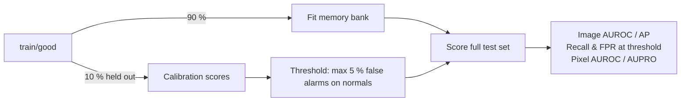

# Industrial Anomaly Detection

[](https://github.com/Zeta-12/industrial-anomaly-detection/actions/workflows/ci.yml)

Unsupervised visual inspection for manufacturing: the model is fitted **on defect-free images only** and must find
cracks, contamination, scratches or wrong imprints it has never seen, and show *where* they are.


The modelling uses well-known methods (PatchCore, PaDiM via [anomalib](https://github.com/open-edge-platform/anomalib)).
The work in this repository is in the **evaluation protocol**: many public anomaly-detection demos tune their
decision threshold on the test set or report a single AUROC. Here every operating-point number comes from a
threshold chosen without looking at a single defective image.

## Results

PatchCore (WideResNet-50-2, `layer2`+`layer3`, 10 % coreset) on the MVTec AD **pill** category, full test set
(26 good / 141 defective), CPU only. The 15-category benchmark is in progress (see [Roadmap](#roadmap)).

| Category | Image AUROC | Image AP | Pixel AUROC | AUPRO@0.3 | Recall @cal. | FPR @cal. | Oracle F1* |
|---|---|---|---|---|---|---|---|
| pill | 0.949 | 0.991 | 0.981 | 0.940 | 0.908 | 0.115 | 0.950 |

\*Oracle F1 uses the best threshold *on the test set*: an optimistic upper bound, not an operating point.

**Operating point.** With the threshold calibrated to allow 5 % false alarms on held-out normal pills, the model
catches **128 of 141 defective pills (91 %)**. On the test set it raises 3 false alarms on 26 good pills (11.5 %),
above the 5 % target: with 27 calibration images the achieved false-alarm rate is noisy (see
[Limitations](#limitations)). The gap between calibrated F1 (0.941) and oracle F1 (0.950) is what tuning on the test
set would have hidden.

| Defect type | Detected |
|---|---|
| combined | 17 / 17 (100 %) |
| pill_type | 9 / 9 (100 %) |
| scratch | 23 / 24 (96 %) |
| contamination | 20 / 21 (95 %) |
| faulty_imprint | 18 / 19 (95 %) |
| crack | 21 / 26 (81 %) |
| color | 20 / 25 (80 %) |
| *good (false alarms)* | *3 / 26 (12 %)* |


### Error analysis

| | |
|---|---|
|  | **Missed colour defect.** The defect is a dot of a few pixels at 256 × 256, with the same hue as the red speckles every normal pill has. It is a resolution limit: PatchCore features have a stride of 8 px. Next step: higher input resolution or tiling. |
|  | **Missed crack.** Faint, low-contrast crack on the pill edge, where normal variability is highest. Colour and crack are the two weakest defect types (80–81 %). |
|  | **False alarm.** The highest-scoring good pill: dense speckles around the "FF" imprint look unusual to the model. |
|  | **Right decision, partly wrong reason.** The crack is found, but a second hot spot sits on the black background. Masking the background (pill segmentation) would remove this class of false alarm. |

**Compute (Intel Core Ultra 5 235U, CPU only).** Fitting takes 24 min, almost all of it in coreset subsampling.
Scoring takes 0.55 s per image end to end, dominated by the nearest-neighbour search in the memory bank.

## Edge deployment: CPU, integrated GPU and NPU

The fitted model is exported to OpenVINO and benchmarked on the three engines of one laptop chip (Intel Core Ultra
5 235U): CPU, integrated GPU and NPU. **Accuracy is re-measured on every target**, not assumed:

- GPU and NPU execute in FP16 by default, and PatchCore scores are distances computed as
  ‖x‖² + ‖y‖² − 2·x·y against a 24 k-vector memory bank, a formula prone to cancellation in half precision.
  `GPU:f32` (same iGPU forced to FP32) separates the effect of execution precision from that of the hardware.
- INT8 is post-training quantization (NNCF) calibrated on the 27 held-out **defect-free** images, so no defect is
  seen. The nearest-neighbour MatMul stays in floating point; only the convolutional backbone is quantized.

| Protocol | |
|---|---|
| Latency | batch 1, synchronous, `PERFORMANCE_HINT=LATENCY`, 10 warm-up + 100 timed runs; p50 / p90 / p99 reported |
| Accuracy | full test set through the compiled model, same calibrated-threshold protocol as the PyTorch reference |
| Agreement | Spearman ρ and max absolute score difference vs PyTorch, image by image |
| Baseline | eager PyTorch FP32 on the same CPU, same input, same loop |
| Conditions | AC power and battery saver checked and recorded (`iad devices`); failures are reported, not dropped |

### Results: pill, Intel Core Ultra 5 235U, on AC power


| Runtime · target · weights | Exec. | p50 (ms) | FPS | Image AUROC | AUPRO | Recall @cal. | Spearman vs PyTorch |
|---|---|---|---|---|---|---|---|
| PyTorch · CPU · fp32 (reference) | f32 | 424.8 | 2.3 | 0.949 | 0.940 | 0.908 | 1.000 |
| OpenVINO · CPU · fp16 | f32 | 273.2 | 3.7 | 0.950 | 0.940 | 0.908 | 1.000 |
| **OpenVINO · iGPU · fp16** | f16 | **123.3** | **8.1** | **0.950** | **0.940** | 0.901 | 0.999 |
| OpenVINO · iGPU forced FP32 · fp16 | f32 | 253.2 | 3.9 | 0.950 | 0.940 | 0.908 | 1.000 |
| OpenVINO · NPU · fp16 | f16 | 482.2 | 2.1 | 0.949 | 0.940 | 0.908 | 1.000 |
| OpenVINO · CPU · int8 | f32 | 230.7 | 4.4 | 0.859 | 0.835 | 0.610 | 0.878 |
| OpenVINO · NPU · int8 | f16 | 438.5 | 2.3 | 0.438 | 0.159 | 0.043 | −0.066 |

All 13 combinations, with p90 / p99 and compile times: [`benchmark_pill.md`](docs/assets/benchmark_pill.md);
raw numbers and environment: [`benchmark_pill.json`](docs/assets/benchmark_pill.json).

**1. Deploy on the iGPU in FP16: 3.4× faster than PyTorch, no accuracy loss.** 123 ms per image (8.1 FPS) against
425 ms, with identical AUROC and AUPRO, and scores correlated at ρ = 0.999 with PyTorch. Latency is also far more
predictable: σ ≈ 1 ms on the iGPU against 29 ms for PyTorch on the CPU.

**2. FP16 is safe for this model; my concern about it was wrong.** Squared norms of memory-bank vectors peak at
9.3 k, well inside the FP16 range (65.5 k), and the largest score deviation is 0.77 for a decision threshold of 35.
FP16 execution makes the iGPU twice as fast as forcing FP32 (123 vs 253 ms) at the same accuracy. The operating point
moves by one image each way (2 false alarms instead of 3, 127 detections instead of 128), within the noise of a
27-image calibration set.

**3. Naive INT8 is a bad trade: 20 % faster on CPU, 3 % on iGPU, recall down from 91 % to 61 %.**
- *Little speed-up*: the nearest-neighbour search (1,024 patches × 24,576 bank vectors × 1,536 dims, 77 GFLOP per
  image) stays in floating point and dominates the cost. The 151 MB memory bank also keeps the INT8 model at 214 MB
  (250 MB in FP32).
- *Large accuracy loss*: the memory bank was built from FP32 features while the queries now come from an INT8
  backbone, so every distance carries the quantization error (scores shift by up to 25). Next experiment: rebuild the
  memory bank with the quantized backbone so that bank and queries share the same error.

**4. The NPU is the slowest target here, and INT8 breaks on it.** In FP16 it is accurate and extremely stable
(σ = 0.5 ms), but at 482 ms it is slower than the CPU: one large dense MatMul followed by a TopK over 24 k vectors is
probably a poor fit for it. With the INT8 model its scores are uncorrelated with PyTorch (ρ = −0.07), while the same
IR reaches 0.86 AUROC on the CPU: an NPU-specific numerical problem, not diagnosed yet. Next experiment: split the
graph, with the backbone on the NPU and the nearest-neighbour search on the iGPU, and time each stage.

Not measured: power draw (no reliable per-engine telemetry on this laptop). First compilation takes about 30 s on the
NPU, so a deployment should cache compiled models (`CACHE_DIR`).

```bash
uv sync --extra openvino
uv run iad devices                          # pre-flight: devices, NPU driver, AC power
uv run iad benchmark --category pill        # export fp32/fp16/int8, then CPU, GPU, GPU:f32, NPU
```

Results go to `runs/<model>/<category>/benchmark/`: `results.json` (every number plus environment), `results.md`,
`latency_accuracy.png`.

## Evaluation protocol



| Choice | Why |
|---|---|
| **Threshold calibrated on held-out defect-free images** | In production there are no labelled defects to tune on. Picking the threshold that maximises F1 on the test set leaks labels; that "oracle F1" is reported only as an upper bound. |
| **Full test set, stratified subsampling for quick runs** | Taking the first *N* files (sorted by folder) silently evaluates on two defect types out of seven. |
| **Pixel-level AUROC and AUPRO@0.3** | Image AUROC says *whether* a part is defective. AUPRO checks *where*, weighting each defect region equally so that tiny contaminations count as much as large cracks. |
| **Raw model scores** | anomalib's post-processor min-max normalises with validation statistics and clamps to [0, 1]; saturated scores create ties that distort ranking metrics. |
| **Heat maps on a shared colour scale** | Per-image min-max normalisation paints a red hot spot on every image, defect-free ones included. Here mid-scale = decision threshold, on every image. |

All metrics are implemented in [`metrics.py`](src/industrial_ad/metrics.py) and unit-tested against cases with
known answers (perfect maps, random maps, equal weighting of regions of very different sizes).

## Quickstart

Requires Python 3.11–3.13 and [uv](https://docs.astral.sh/uv/).

```bash
git clone https://github.com/Zeta-12/industrial-anomaly-detection.git
cd industrial-anomaly-detection
uv sync                     # CPU wheels

uv run iad download         # MVTec AD, 4.9 GB, CC BY-NC-SA 4.0 (non-commercial)
uv run iad run --category pill                 # fit + calibrate + evaluate one category
uv run iad run --category all --model padim    # every category, another model
uv run iad summary --model patchcore           # markdown table over evaluated categories
```

Each run writes to `runs/<model>/<category>/`:

| File | Content |
|---|---|
| `metrics.json` | every metric, the thresholds, timings, library versions and the exact config |
| `scores.csv` | per-image score and decision |
| `score_distribution.png`, `curves.png` | score histograms with the threshold, ROC and PR curves |
| `panels/` | best-detected and hardest example of each defect type, highest-scoring normal image |
| `split.json` | which training images were used for fitting vs calibration |

## Repository layout

```
src/industrial_ad/
├── data.py       MVTec-layout indexing, fit/calibration split, stratified subsampling
├── models.py     anomalib model construction, fitting, raw scoring
├── metrics.py    calibrated threshold, image metrics, pixel AUROC, AUPRO
├── pipeline.py   train / evaluate / summary
├── export.py     OpenVINO IR export: fp32, fp16, int8 (NNCF post-training quantization)
├── benchmark.py  latency + accuracy per device (CPU / iGPU / NPU), PyTorch baseline
├── viz.py        panels, score distributions, ROC / PR curves, latency-accuracy trade-off
└── cli.py        `iad` command
tests/            unit tests on a synthetic MVTec-layout dataset (no download, runs in CI)
configs/          default.yaml: every parameter in one place
```

## Limitations

- The calibration set is small (~27 images per category), so the achieved false-positive rate moves in steps of
  roughly 4 % and varies with the split seed.
- Pixel metrics are computed at the model resolution (256 × 256), not the original image resolution.
- MVTec AD has controlled lighting and pose. A real production line also needs monitoring of drift in the
  normal-score distribution.

## Roadmap

- [x] Calibrated threshold, pixel metrics, error analysis: pill category
- [ ] All 15 MVTec AD categories, PatchCore vs PaDiM (and EfficientAD, trained on GPU)
- [x] OpenVINO FP32 / FP16 / INT8 export, CPU / iGPU / NPU latency + accuracy benchmark on pill
- [ ] INT8 with a memory bank rebuilt from the quantized backbone
- [ ] Split pipeline (backbone on NPU, nearest-neighbour search on iGPU) with per-stage latency
- [ ] Diagnose the NPU INT8 failure
- [ ] Benchmark on all categories
- [ ] Interactive demo (Gradio, Hugging Face Spaces)
- [ ] REST service (FastAPI) and Docker image
- [ ] Variance of the calibrated operating point across split seeds

## Dataset and licence

[MVTec AD](https://www.mvtec.com/company/research/datasets/mvtec-ad) (Bergmann et al., CVPR 2019 / IJCV 2021) is
distributed under CC BY-NC-SA 4.0 and is **not** included in this repository. Code: Apache 2.0.

## Author

**Julien Beloin**, Machine Learning & Computer Vision Engineer ·
[LinkedIn](https://www.linkedin.com/in/j-beloin) · [GitHub](https://github.com/Zeta-12)
